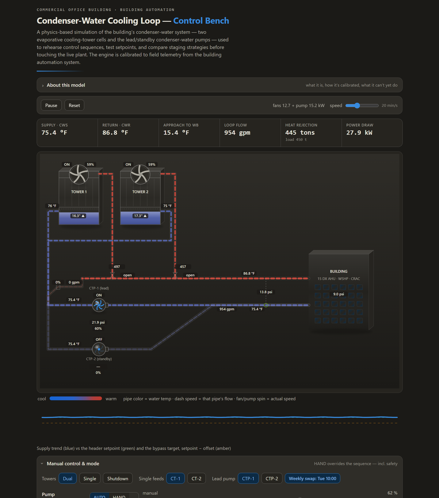

# Condenser-Water Loop — Control Bench

A physics-based, browser-based simulator of a commercial building's condenser-water cooling loop — two evaporative cooling-tower cells and lead/standby condenser-water pumps. One self-contained HTML file: no build, no dependencies, no backend.

It's a **control and efficiency test bench**, not a data historian — a place to rehearse the cooling-tower sequence of operations, try setpoints and controller tuning, compare pump/fan staging, and see the energy cost, against a model calibrated to real plant telemetry. Open `index.html` and it runs.

## What it does

- **Live animated schematic** — pipe color tracks water temperature, dash speed tracks flow, fans and pumps spin at their modeled speed, basins fill to their modeled level, with live values at each sensor and valve.
- **Two sequences, switchable live** — the **program running on the tower controller** (one PI loop driving both fans with a minimum running speed, a bypass loop with a winter limit, a DP cascade from the remote floor DP to the header DP to pump speed, a weekly pump swap, makeup level control), or the **documented design sequence** (lead/lag fan staging, warming bypass hold/close, WSHP low-limit and basin-freeze trips, pump speed floor). Take any actuator to **HAND** to override either one, safeties included, and drive the plant into failure modes on purpose.
- **KPI faceplate** — supply / return temperature, approach to wet-bulb, loop flow, heat rejection, and live electrical power draw (fans + pump).
- **Everything adjustable, live** — setpoints, sequencing thresholds, the controller's loop gains in its own units, tower and hydraulic constants, the water side (makeup, evaporation, holdup), ambient (OAT / wet-bulb), and a weather-driven building-load model with a weekday clock.
- **Optional live weather** — pick any US METAR/ICAO station (e.g. `KJFK`) or a global `lat,lon` pair, and the sim drives OAT + wet-bulb from real observations (NWS, with an Open-Meteo fallback). It's the only network call; everything else runs locally.
- **Alarm flags** — low NPSHa, low flow, low CWS, freeze, freeze risk, OAT lockout, over-HP, air ingestion, basin overflow, pump deadhead, basin low, and ΔT clamp.

## The model

- **Pumps** — affinity laws on a manufacturer head curve with a part-load efficiency curve. The loop is solved on the return-header pressure: the building loop and pump in series, then the tower risers (which carry the open-tower lift) in parallel with the warming bypass (which skips it), so a half-open bypass takes most of the flow.
- **Cooling tower** — an open evaporative crossflow tower in effectiveness (ε-NTU) / air-side Merkel form on the wet-bulb enthalpy driving force; airflow follows fan speed, with a natural-draft floor (a tower total, shared by the wet cells) when the fans are off. A lone wet cell loses some of its fan's air at low speed, and the two cells split the flow unevenly, as measured.
- **Thermal transport** — first-order lags on the hot and cold legs, pinned to the measured loop transients.
- **Water side** — each cold basin's level in inches on its metered gallons-per-inch, the two basins coupled through the shared pump suction, makeup into the pump discharge under the controller's level logic and fail-safe timers, evaporation from the heat rejected, the water held up on the hot-water basins and fill (a pump stop gives it back), and air ingestion that collapses the tower flow when a basin runs low.
- **Sensors** — the controller sees what its sensors see: the header supply sensor sits next to the makeup tie-in and reads a plume of makeup water during a fill, and the outdoor sensor reads warm.
- **Building load** — heat on the loop from the AHUs' compressor stages: a 24/7 IT/CRAC floor, a fixed slice of heat per compressor stage running (compressor heat included), an economizer gate on outdoor temperature and enthalpy, a weekday schedule with after-hours overrides, and water-source heat pumps pulling heat from the loop in cold weather.

The hydraulics, tower, water side, sensor effects and building load are fit to a late-summer-to-fall season of 2-minute building-automation (BAS) trends with an on-site weather station; the equipment skeleton — tonnage, pump curve and horsepower, pipe sizes, basin geometry — is the real installed plant.

## Accuracy & limitations

It's a model, best used for **relative** comparisons (this staging vs. that one, this setpoint vs. that one) and for rehearsing sequences. Every number below comes from replaying the model's own engine through the field trends, poll by poll:

- **Hydraulics** — loop flow within −9 gpm on average (RMS 29 gpm), pump DP within 0.35 psi RMS.
- **Tower** — fed the measured inlet, flow, fan speed and wet bulb, each cell's leaving water is within +0.12 °F on average (RMS 0.74 °F, ~52,000 steady polls); at the manufacturer's certified selection point it leaves 85.5 °F against the certified ~85 °F.
- **Whole plant** — with the fans, pump and bypass forced to what was measured, supply runs 0.8 °F cold (RMS 2.9 °F); with the controller program running everything on the real setpoints, 0.5 °F cold (RMS 2.4 °F), pump speed within 0.9 % RMS, and as many makeup fills a day as the real plant.
- **Building load** — 34 t RMS per poll and 20 t on daily means, with no bias.
- **Hold-out** — on three days after the fit, data the model never saw: flow within +4 gpm (RMS 12), the tower alone within −0.1 °F (RMS 0.45 °F), makeup fills matched. With the fans off at ~50 t the whole loop ran 2 °F cold, which at that load is only ~2.6 t of heat: at light load a tiny heat imbalance moves the loop temperature a lot.

Known limits:

- **Cold weather is extrapolated** — the fit reaches the first winter-mode night (~35 °F) but has no sub-freezing data, so fans-off free cooling, the bypass in deep cold, freeze and the heat pumps' winter draw are provisional.
- **The tower is weak below ~400 gpm per cell** — it's fit on 460–1,000 gpm per cell; in loss-of-flow hours (200–400 gpm, fans high) it rejects too little heat, and a wide-open bypass is the same regime.
- **Loop resistance is fixed** — correct in form for this constant-flow building, but the measured resistance drifts about ±8 % with load and weather and the model doesn't follow it.
- **The building-load model is a late-summer and fall fit** — it under-predicts warm, dry, sunny afternoons when the AHUs are locked out by dry bulb at low enthalpy (one hold-out afternoon ran ~60 t over the model), and the heat-pump heating side is extrapolated below 37 °F.
- **Basin levels** — the fill valve's stroke, the level sensor's lag and a slow day-to-day drift between the two basins aren't modeled.
- **Quasi-steady thermal response** — steady-state behavior is the trustworthy part; transient accuracy isn't scored on its own.

## How to use it

- **Run it** — open `index.html` in any modern browser. To serve it live, use GitHub Pages (Settings → Pages → deploy from branch, root folder).
- **Drive it** — press **Pause/Run** to let the sequence operate the plant, or take an actuator to **HAND** to override it. Switch sequences under **Setpoints & sequencing**; set **Load source** to *building* and use the clock to run a day. Watch the faceplate and the **power draw** figure to weigh the energy cost of staging and setpoint choices.
- **Adapt it to another plant** — the model is generic in form and specific in numbers. Most site constants live in the `CFG` object; a few engine constants (pump curve, basin geometry, outlet air-ingestion curve, fan kW) sit nearby — all near the top of the `<script>` block, with inline notes on what each one is. Re-fit the hydraulics from a couple of pump-speed points and the tower from a fan / wet-bulb sweep. The SVG schematic is hand-laid for a two-cell layout, so a different plant topology means editing the SVG and its render bindings, not just the numbers.

## Stack

Vanilla HTML / CSS / JavaScript — no frameworks, no build, no dependencies. A single file you can read top to bottom.

## License

MIT — see [LICENSE](LICENSE).

## Disclaimer

An engineering and teaching tool. All outputs are model estimates and carry the limitations above; verify independently before acting on a real plant. The build is de-identified — no site, owner, tenant, or equipment-make information — while keeping the real equipment profile for realism.
